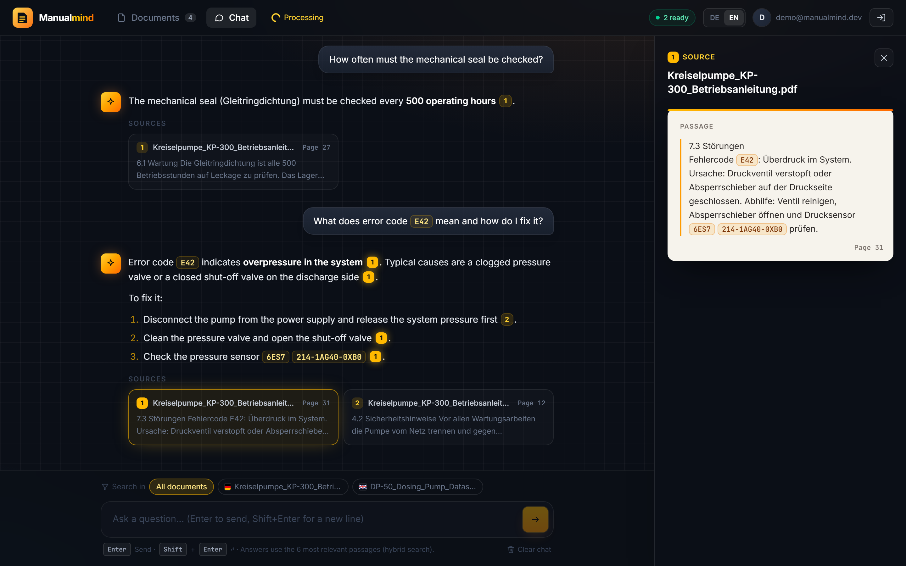
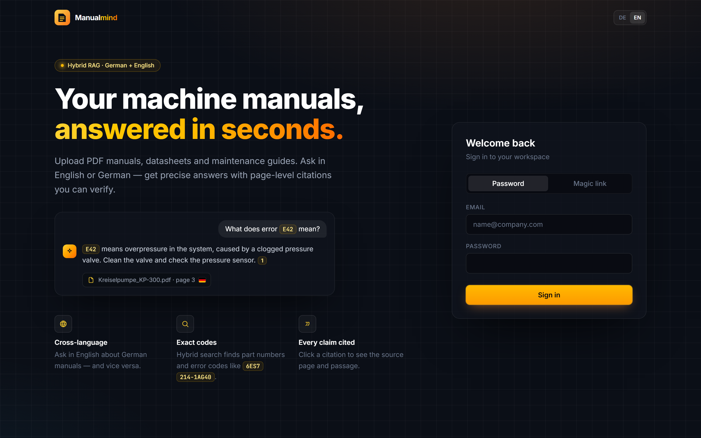
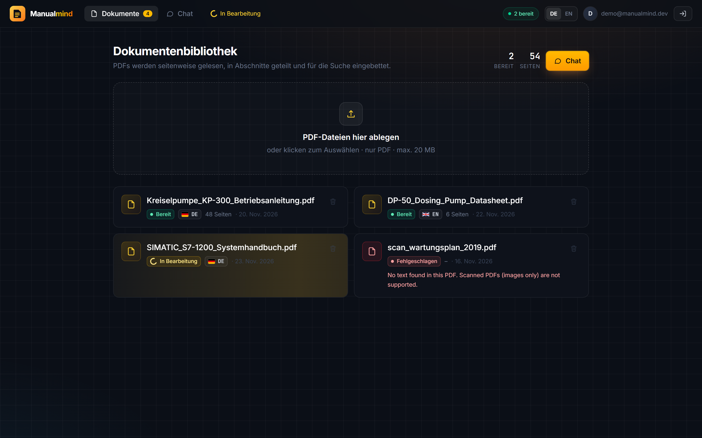
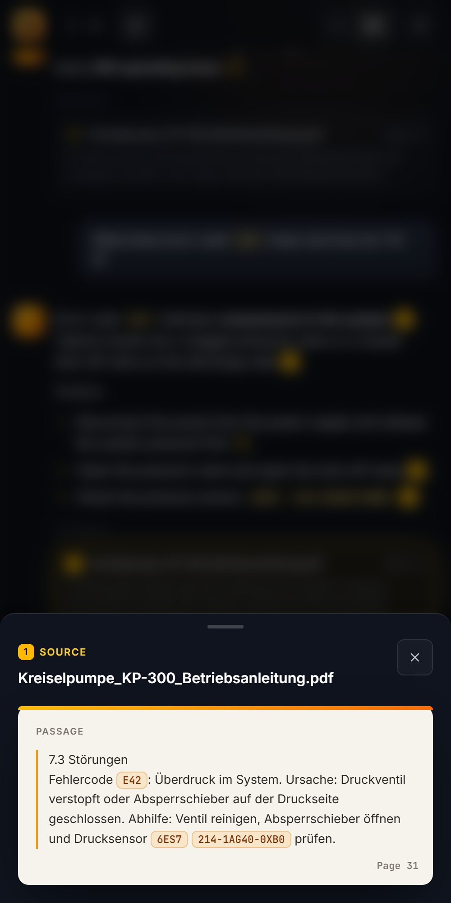
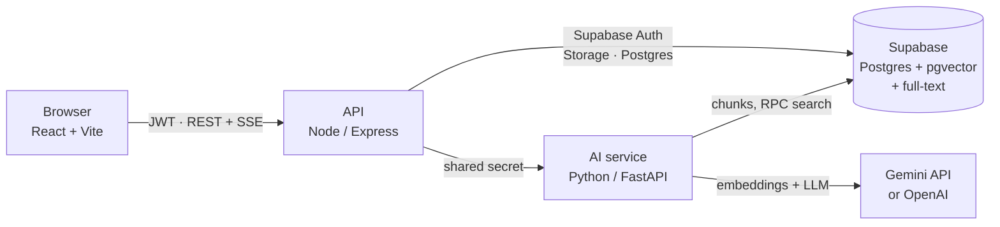
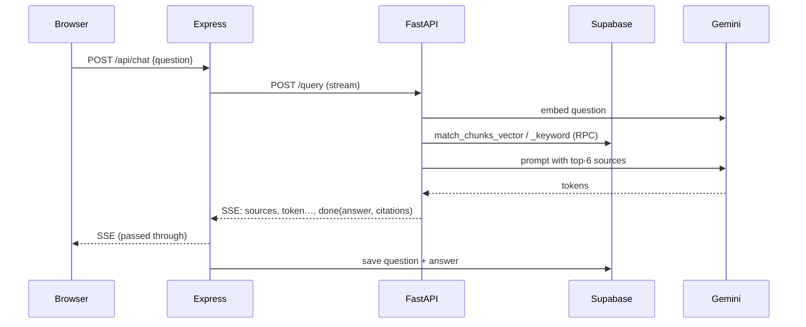

# Manualmind — multilingual RAG for industrial documentation

Upload PDF machine manuals, datasheets and maintenance guides in **German or English**, ask questions in
**either language**, and get answers with **page-level citations** you can click and verify.



| Landing page | Document library | Mobile |
|---|---|---|
|  |  |  |

## Highlights

- **Cross-language Q&A** — ask in English about a German manual (and vice versa); the answer comes back in the
  language of the question, with citations to the original page.
- **Adaptive hybrid search** — vector search (pgvector) plus Postgres full-text search for exact identifiers such as
  error codes and part numbers (`E42`, `6ES7 214-1AG40`), merged with Reciprocal Rank Fusion.
- **Every claim cited** — `[1]`-style citations become chips; clicking one opens the passage, document and page.
- **Streaming answers** over Server-Sent Events, chat history, document filter, DE/EN interface, responsive down to
  phone width.
- **Measured, not guessed** — an evaluation suite on 4 real manufacturer manuals (208 pages, 40 questions, 24 of them
  cross-language) drove the design decisions below.
- **Free-tier friendly** — runs on Gemini's free API: token-aware rate limiting for embeddings, a model fallback
  chain with cooldown for overloaded models, and clear messages when a daily quota is used up.

## Results

Evaluation on 4 public manuals (SEW MOVITRAC LTE-B · Wilo-Stratos PICO plus · Danfoss VLT FC 51 · Grundfos CR) with
40 page-checked questions — see [`eval/`](eval/README.md).

| Retrieval mode | Hit rate @6 | MRR @6 | Cross-language hit @6 | Code/part-number hit @6 |
|---|---|---|---|---|
| keyword only | 57% | 0.43 | 42% | 100% |
| vector only | 100% | 0.92 | 100% | 100% |
| **hybrid (adaptive, production)** | **100%** | **0.91** | **100%** | **100%** |

- **Answer language:** 100% of answers in the language of the question (40/40, incl. 24 cross-language).
- **Answer quality (LLM judge, 1–5):** faithfulness and correctness are being collected on the free tier; the
  answers judged so far scored 5/5 on both — `python eval/run_eval.py --resume` completes the run.

### What the evaluation changed

| Change | Before | After |
|---|---|---|
| Equal-weight RRF → **adaptive hybrid** (keyword search only for questions with identifiers) | 70% hit @6 | 82% |
| **Document title** passed to the embedding model for every chunk | 88% hit @6, MRR 0.72 | 100%, MRR 0.92 |
| Explicit "Answer in English / Antworte auf Deutsch" at the end of the prompt | 82% answers in question language | 100% |

Keyword search alone cannot match across languages, and OR-ed generic words flooded the rank fusion with noise —
on cross-language questions it pushed the right page out of the top 6 (e.g. answering the Danfoss max. temperature
with SEW's 50 °C instead of 40 °C). Spec tables rarely repeat the product name, so giving the embedding model the
document title tied them to the right product. Details: [docs/DEVELOPMENT.md](docs/DEVELOPMENT.md).

## Architecture



**Ingestion** — upload (Express, multer) → Supabase Storage + `documents` row → FastAPI background task: PyMuPDF text
per page → language detection → chunks of ≤500 tokens with 50-token overlap, never across pages → embeddings
(`gemini-embedding-001`, 1536 dims, document title as context) → `chunks` table with `vector` and `tsvector`.

**Question** — embed the question → vector top 20 (+ keyword top 20 if the question contains identifiers, merged
with RRF) → top 6 chunks labelled `[1]…[6]` with document and page → LLM with strict rules (answer in the question's
language, use only the sources, cite, say so if the answer is missing) → citations parsed and mapped back to pages →
streamed to the browser; question and answer are stored in `chat_messages`.



## Tech stack

| Layer | Technology |
|---|---|
| Frontend | React 19, Vite, TypeScript, Tailwind CSS v4 |
| API | Node.js, Express 5, TypeScript, multer, Supabase JS |
| AI service | Python, FastAPI, PyMuPDF, tiktoken, langdetect, google-genai / openai |
| Database | Supabase Postgres with pgvector (HNSW) and full-text search (`simple` config), Row Level Security |
| Auth & files | Supabase Auth (password / magic link), Supabase Storage |
| Models | `gemini-embedding-001` (1536 dims) · `gemini-3.1-flash-lite` with fallbacks — or OpenAI via env vars |
| Tests | pytest (74), Jest + Supertest (16) |
| Deployment | Vercel (frontend) · Render (API + AI service, Docker) · Supabase |

## Run locally

**Prerequisites:** a Supabase project, a Gemini API key (free at [aistudio.google.com](https://aistudio.google.com)),
Docker Desktop (or Node 22+ and Python 3.12+).

1. **Database:** run [`supabase/migrations/20261118000000_init.sql`](supabase/migrations/20261118000000_init.sql)
   in the Supabase SQL editor (tables, indexes, RLS, search functions, storage bucket).
2. **Auth:** in Supabase → Authentication, enable Email and set the Site URL to `http://localhost:5173`.
3. **Config:** `cp .env.example .env` and fill in the Supabase URL/keys, `GEMINI_API_KEY` and a random
   `AI_SERVICE_SECRET`.
4. **Start:**
   ```bash
   docker compose up --build
   ```
   Open http://localhost:5173. Without Docker: run `uvicorn app.main:app --port 8000` in `ai-service/` (venv),
   `npm run dev` in `backend/` and `frontend/`.

Check the Supabase setup with `cd backend && npm run check-setup`. A preview of the signed-in UI with sample data
(no account needed) runs at http://localhost:5173/?demo in development.

## Deploy

1. **GitHub:** push this repository (`.env` and third-party PDFs are git-ignored).
2. **Render** → New → **Blueprint** → select the repo. [`render.yaml`](render.yaml) creates `manualmind-ai` and
   `manualmind-api` (Docker, free plan). Enter the Supabase URL + service-role key and `GEMINI_API_KEY`; set the API's
   `AI_SERVICE_URL` to the AI service URL (`https://manualmind-ai.onrender.com`) and `CORS_ORIGIN` to your Vercel URL.
3. **Vercel** → New Project → the repo, **Root Directory `frontend`** ([`vercel.json`](frontend/vercel.json)).
   Environment variables: `VITE_SUPABASE_URL`, `VITE_SUPABASE_ANON_KEY`, `VITE_API_URL`
   (`https://manualmind-api.onrender.com`).
4. **Supabase** → Authentication → URL Configuration: add the Vercel URL as Site URL / redirect URL.

The service-role key and the Gemini key only live on Render; the browser gets the public anon key and the API URL.
Render's free plan sleeps after 15 minutes without traffic, so the first request takes about a minute.

## Evaluation

```bash
ai-service\.venv\Scripts\python eval\multilingual_check.py   # ingest eval/docs, DE⇄EN check (answers + citations)
ai-service\.venv\Scripts\python eval\run_eval.py --no-answers # vector vs keyword vs hybrid: hit rate, MRR
ai-service\.venv\Scripts\python eval\run_eval.py --resume     # + answers and LLM judge (faithfulness, correctness)
```

The manuals are not part of the repository — download links are in [`eval/README.md`](eval/README.md).

## Project structure

```
frontend/      React app (landing/login, documents, chat, citation panel, DE/EN)
backend/       Express API: auth, uploads, chat SSE proxy, history
ai-service/    FastAPI: ingestion, embeddings, retrieval (vector / keyword / adaptive hybrid), LLM, citations
supabase/      SQL migration (schema, RLS, RPC search functions, storage bucket)
eval/          questions, multilingual check, evaluation, results
docs/          development log, screenshots
render.yaml    Render blueprint · docker-compose.yml for local runs
```

## Tests

```bash
cd ai-service && .venv\Scripts\python -m pytest     # chunking, RRF, retrieval, prompts, citations, rate limits, API
cd backend && npm test                              # upload/list/delete, auth, chat SSE proxy, history
```

## Known limitations

- **Free-tier quotas:** Gemini's free tier allows ~1,000 embedding requests per day, and every chunk counts as one
  (the 4 test manuals ≈ 630), plus small daily per-model LLM limits. The app waits for per-minute limits and shows a
  clear message when a daily quota is used up; a paid key or `EMBEDDING_PROVIDER=openai` removes this.
- No OCR: scanned PDFs (images only) are rejected with "no text found". Tables lose their layout in text extraction.
- Answers use the 6 best chunks; information spread over many pages can be incomplete.
- Multi-language PDF bundles should be split per language before upload.
- The LLM judge belongs to the same model family as the answering model.
- Uploaded content is sent to the configured AI provider; on Gemini's free tier Google may use it to improve its
  models — don't upload confidential documents there.
